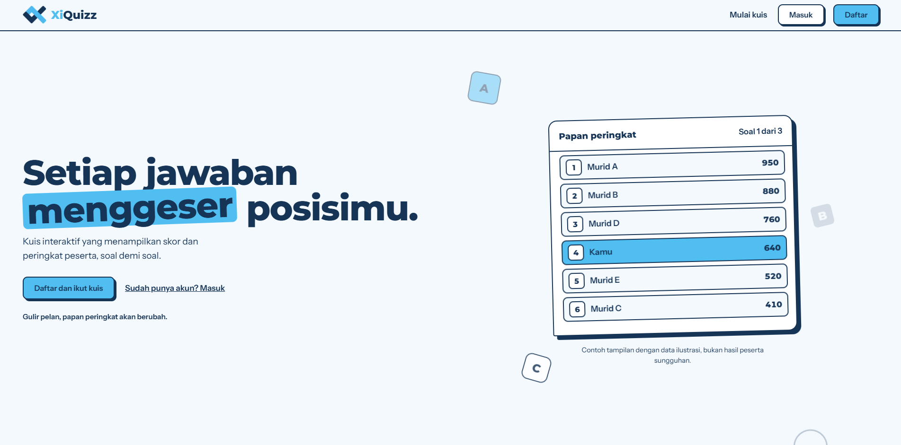
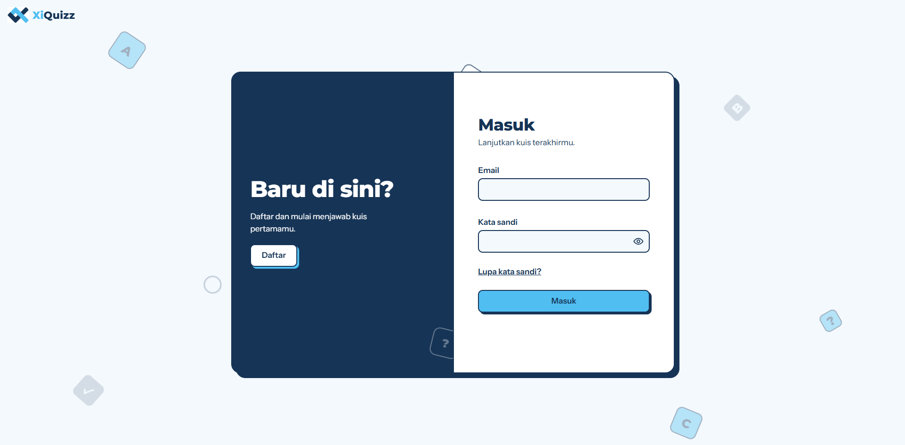
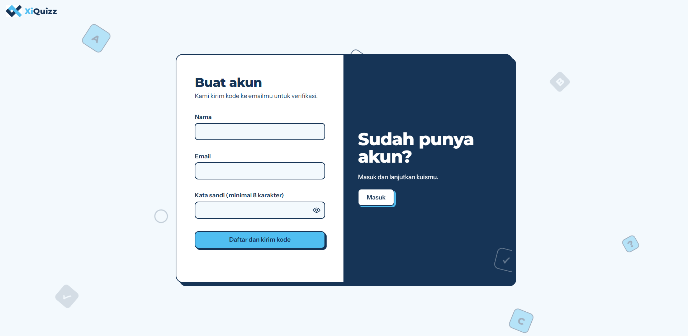

  

<h1 align="center">XiQuizz</h1>

  Kuis interaktif yang menampilkan skor dan peringkat peserta, soal demi soal. 
  <b>Setiap jawaban menggeser posisimu.</b>

  <a href="https://www.xiquizz.com"><b>www.xiquizz.com</b></a>

---

## Tampilan

| Masuk | Daftar |
|---|---|
|  |  |

## Tentang proyek

XiQuizz membuat kuis di kelas terasa seperti pertandingan. Guru membuat kuis, membagikan PIN atau QR, dan siswa bergabung dari ponsel mereka. Papan peringkat berubah setiap soal, jadi posisi siswa bisa naik atau turun sampai soal terakhir.

## Alur kuis

1. Guru membuat kuis dan menekan **Buat PIN dan QR**
2. Layar guru menampilkan QR dan ruang tunggu
3. Siswa scan QR atau mengetik PIN, lalu masuk dengan User ID dan kata sandi
4. Siswa muncul satu per satu di ruang tunggu
5. Guru menekan **Mulai kuis**, soal berjalan, peringkat bergerak
6. Di akhir, ada papan peringkat akhir dan analisis per soal

## Fitur

### Guru
- Membuat kuis, menyimpannya di library, dan mengelola kelas
- Dua mode timer: waktu per soal, atau waktu seluruh kuis
- Tampilan proyektor untuk kuis yang sedang berjalan: soal, kunci jawaban, sebaran pilihan siswa, dan leaderboard
- Leaderboard sementara di antara soal, dan leaderboard live untuk mode waktu seluruh kuis
- Analisis hasil per soal
- Memilih tampilan ruang tunggu sendiri dari library lobi
- Toko untuk membeli tipe soal dan lobi tambahan dalam satu keranjang dan satu pembayaran

### Siswa
- Bergabung lewat scan QR atau PIN
- Poin lebih besar untuk jawaban yang lebih cepat
- Melihat benar atau salah dan poinnya setelah setiap soal
- Leaderboard per kelas dan per mata pelajaran dengan poin akumulasi
- Profil dengan foto yang bisa dipotong dan ganti kata sandi dengan verifikasi OTP

### Admin
- Mengelola akun guru dan penyimpanan tiap guru
- Library tipe soal: pasang, perbarui, kembalikan ke versi sebelumnya, aktifkan atau nonaktifkan
- Library lobi, termasuk menetapkan lobi bawaan
- Keuangan dan transaksi
- Pengelola isi landing page

## Tipe soal

Pilihan ganda, pilihan ganda kompleks, benar atau salah, isian singkat, menjodohkan, dan mengurutkan.

Setiap tipe soal berdiri sendiri, jadi memperbarui satu tipe tidak mengganggu tipe lain. Tipe baru bisa ditambahkan tanpa mengubah aplikasi.

## Lobi

Ruang tunggu di layar guru bisa diganti temanya. Tiap lobi punya desain avatar, tampilan peringkat 1 sampai 3 dan runner up, animasi masuk, serta tiga gaya keluar: asap, disedot jadi pixel, dan batu nisan.

## Teknologi

- HTML, CSS, dan JavaScript tanpa framework frontend
- Backend serverless dengan Node.js
- PostgreSQL
- Ekspor hasil ke Excel
- Tes end-to-end, keamanan, dan antarmuka

## Link

[www.xiquizz.com](https://www.xiquizz.com)
"# xiquizz.com" 
